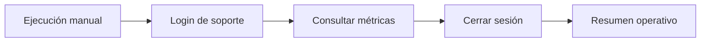

# n8n · resumen de soporte

Dos flujos manuales importables, sin servicios de pago ni modelos de IA:

- `demo-resumen.json`: datos ficticios → resumen. Resultado esperado: 12 tickets, 5 pendientes, 6 resueltos y 1 cerrado. No necesita ejecutar Support Metrics.
- `resumen-api.json`: login → métricas globales → logout → resumen. Consulta la API existente sin modificar tickets. No es una alerta en tiempo real ni un reporte de tickets creados hoy: muestra el estado global en el instante de consulta.



## Ver la demostración

Desde la raíz del repositorio, con Docker Desktop activo:

```sh
docker compose -f integrations/n8n/compose.yaml up -d
```

Abre http://localhost:5678 y configura tu cuenta local de n8n. En un workflow nuevo, usa el menú **Import from File** y selecciona `demo-resumen.json`. Pulsa **Execute workflow** y abre la salida del nodo **Resumen de soporte**. Los cuatro contadores permiten comparar el resultado con los datos de entrada.

El servicio se publica solo en la interfaz local; el volumen conserva tu configuración y credenciales entre reinicios. Para detenerlo sin borrar datos:

```sh
docker compose -f integrations/n8n/compose.yaml down
```

Validación local: ambos flujos se importaron y ejecutaron con n8n 2.46.4. La demo produjo exactamente 12 tickets, 5 pendientes, 6 resueltos y 1 cerrado.

El 3 de noviembre de 2026 se conectó el flujo autenticado con la API y el volumen PostgreSQL habituales del proyecto. Se verificaron sus contadores contra una consulta directa de la base y se confirmó que no quedaban sesiones activas de la cuenta de integración después del logout. En Docker Desktop, `host.docker.internal:3000` alcanzó correctamente la API que escucha en `127.0.0.1:3000`.

En la instancia configurada, abre [el flujo real](http://localhost:5678/workflow/supportMetricsApi) y pulsa **Execute workflow**. La credencial ya está asociada localmente al nodo Login. Para otra instalación, sigue los pasos siguientes: el repositorio no contiene esa credencial ni sus identificadores privados.

## Conectar la API real

1. Inicia Support Metrics y su base local como indica el README principal. Crea una cuenta de soporte para esta integración: `npm run auth:create -- automatizacion support`. La contraseña se introduce en la terminal.
2. Importa `resumen-api.json`. En **Login**, crea una credencial **Custom Auth** con este contenido, sustituyendo los valores únicamente en el almacén de credenciales de n8n:

   ```json
   {"body":{"username":"automatizacion","password":"TU_CONTRASEÑA_LOCAL"}}
   ```

3. En **Configuración**, `baseUrl` es la dirección alcanzable desde n8n. En Docker Desktop se propone `http://host.docker.internal:3000`. `appOrigin` debe coincidir exactamente con `APP_ORIGIN`, por defecto `http://127.0.0.1:3000`. Son valores distintos porque n8n corre dentro de un contenedor.
4. El servidor habitual escucha en loopback. Según la red de Docker Desktop, puede que el contenedor no consiga acceder: comprueba esa conectividad antes del flujo. No cambies la autenticación ni CORS para resolverla. Como alternativa, ejecuta n8n en el host y cambia `baseUrl` a `http://127.0.0.1:3000`.
5. Ejecuta el workflow completo y revisa **Resumen de soporte**. Las credenciales no están incluidas en el JSON del repositorio. No actives reintentos automáticos de login: la API limita los intentos.

La sesión se toma de `Set-Cookie`, se utiliza para leer las métricas y se revoca en el paso de logout. Si una petición falla antes de logout, el flujo se detiene y la sesión queda hasta su caducidad habitual (8 horas); no se promete limpieza ante errores. No exportes ejecuciones con cookies. La configuración evita guardar ejecuciones, pero sus salidas pueden verse durante una ejecución manual.

La automatización usa un usuario de soporte porque todavía no existe una credencial de servicio con permisos de solo lectura. Los workflows permanecen inactivos y sin horario. Un siguiente paso sería añadir un horario y un destino de notificaciones elegido por el propietario.

## Servicios necesarios

El flujo real requiere los tres servicios encendidos: PostgreSQL, API y n8n. Los contenedores conservan sus datos en volúmenes; la API se inicia con `npm start` desde el proyecto que contiene su `.env`. Tras reiniciar el equipo, inicia esos servicios antes de ejecutar el workflow. Esta integración no configura el arranque automático de Windows ni publica la API en Internet.

Referencias oficiales: [Docker](https://docs.n8n.io/hosting/installation/docker/), [importar workflows](https://docs.n8n.io/workflows/export-import/), [credenciales HTTP Custom Auth](https://docs.n8n.io/integrations/builtin/credentials/httprequest/).
